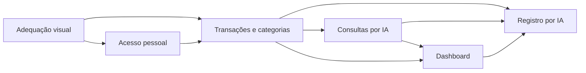

# FinAI — MVP

## Objetivo

Permitir controle financeiro pessoal por interface e por IA real, com registros persistidos e separados por titular. O MVP mantém as decisões funcionais aprovadas e seis Features com fluxo e aceite próprios.

## Catálogo vigente

| Feature                                        | Requisito                                                                                    | Fluxo e resultado                                                                         | Aceite na aplicação                                                                                        |
| ---------------------------------------------- | -------------------------------------------------------------------------------------------- | ----------------------------------------------------------------------------------------- | ---------------------------------------------------------------------------------------------------------- |
| Adequação visual completa                      | [#1016270](../../features/1016270-adequacao-visual-completa-do-finai/feature.md)             | Navegar nas telas atuais com identidade, layout e componentes consistentes.               | Comparar todas as telas e estados com o design fornecido, preservando operações e permissões.              |
| Acesso autenticado e espaço financeiro pessoal | [#1016271](../../features/1016271-acesso-autenticado-e-espaco-financeiro-pessoal/feature.md) | Cadastrar, confirmar e-mail, entrar, recuperar senha, sair e reencontrar a própria conta. | Usar formulários e links reais, com duas contas e os estados de confirmação.                               |
| Gestão de transações e categorias              | [#1016274](../../features/1016274-gestao-de-transacoes/feature.md)                           | Criar, classificar, consultar, filtrar, editar e excluir receitas/despesas.               | Usar formulário, histórico e detalhes; verificar categorias e isolamento de registros.                     |
| Assistente de consulta financeira              | [#1016276](../../features/1016276-assistente-de-consulta-financeira/feature.md)              | Perguntar sobre transações e retomar conversa contínua salva.                             | Conferir respostas reais da IA, contexto, períodos, categorias e acesso aos próprios dados.                |
| Dashboard financeiro                           | [#1016275](../../features/1016275-dashboard-financeiro/feature.md)                           | Consultar indicadores, selecionar mês, acessar registros e abrir o chat.                  | Comparar valores com transações reais e executar os controles da tela, inclusive o convite ao chat pronto. |
| Registro de transações por IA com confirmação  | [#1016277](../../features/1016277-registro-de-transacoes-por-ia-com-confirmacao/feature.md)  | Preparar propostas, aceitar sugestões, revisar e confirmar individualmente.               | Conferir o registro real no histórico, nas consultas e no dashboard na conclusão.                          |

Categorias pertencem à Gestão de transações: quatro de receita e oito de despesa, comuns a todos e sem manutenção pelo usuário.

## Ordem e dependências

**Adequação visual → Acesso pessoal → Transações e categorias → Consultas por IA → Dashboard → Registro por IA.**

Cada Feature conclui pelo próprio fluxo, consumindo capacidades anteriores prontas. A classificação, os registros e o vocabulário são compartilhados entre os canais; sua apresentação e verificação pertencem à Feature que entrega cada tela.

## Decisões funcionais

- Qualquer pessoa pode criar uma conta pessoal. Exigir confirmação do e-mail antes do uso financeiro.
- Cada usuário consulta e altera apenas os próprios dados.
- Categorias de receita: Salário, Freelance, Rendimentos e Outras receitas.
- Categorias de despesa: Alimentação, Moradia, Transporte, Saúde, Educação, Lazer, Compras e Outras despesas.
- Transações realizadas em BRL, com data até hoje e referência America/Sao_Paulo. Os limites e campos estão no requisito de transações.
- Exclusão exige confirmação, retira o registro dos cálculos e não oferece desfazer.
- Saldo geral considera todo o histórico, sem saldo inicial separado. Indicadores mensais usam o mês selecionado e recentes mostram os cinco últimos registros de todo o histórico.
- O chat mantém uma conversa contínua por titular. Consultas usam dados reais atuais; sem período ou contexto aplicável, totais usam mês corrente.
- Uma mensagem pode gerar várias propostas. Dados omitidos são perguntados ou sugeridos para aceitação; nunca completados silenciosamente.
- Aceitar sugestões não grava transações. Cada proposta completa exige confirmação final individual.
- Uma única QA cobre cada Feature.

## Design e fontes

Usar o design fornecido e as adaptações funcionais definidas nos requisitos. Telas existentes sem mockup próprio recebem a mesma linguagem visual; as Features financeiras usam essa base e entregam suas composições específicas.

Fontes compartilhadas: [design fornecido](sources/FinAI-Controle-Financeiro.zip) e [escopo fornecido](sources/escopo-inicial.md).

Matriz visual: 360×800, 390×844, 430×932, 600×960, 820×1180, 1024×768, 1366×768, 1440×900 e 1920×1080, com transições 767/768px e 1024/1025px.

## Slicing publicado

| Feature                           | Tarefas                                                                                                                               | Estimativas               | Sequencing            |
| --------------------------------- | ------------------------------------------------------------------------------------------------------------------------------------- | ------------------------- | --------------------- |
| Adequação visual                  | [Slicing](../../features/1016270-adequacao-visual-completa-do-finai/slices/slices.md), DEV #1016281–#1016287 e QA #1016288            | 13,5h DEV + 4h QA = 17,5h | 1–8; pai espelha 1    |
| Acesso pessoal                    | [Slicing](../../features/1016271-acesso-autenticado-e-espaco-financeiro-pessoal/slices/slices.md), DEV #1016292 e QA #1016293         | 2h DEV + 1,5h QA = 3,5h   | 9–10; pai espelha 9   |
| Gestão de transações e categorias | [Slicing](../../features/1016274-gestao-de-transacoes/slices/slices.md), DEV #1016351–#1016355 e QA #1016356                          | 10h DEV + 2h QA = 12h     | 11–16; pai espelha 11 |
| Assistente de consulta financeira | [Slicing](../../features/1016276-assistente-de-consulta-financeira/slices/slices.md), DEV #1016364–#1016368 e QA #1016369             | 16h DEV + 4h QA = 20h     | 17–22; pai espelha 17 |
| Dashboard financeiro              | [Slicing](../../features/1016275-dashboard-financeiro/slices/slices.md), DEV #1016378–#1016384 e QA #1016385                          | 9,5h DEV + 3,5h QA = 13h  | 23–30; pai espelha 23 |
| Registro por IA com confirmação   | [Slicing](../../features/1016277-registro-de-transacoes-por-ia-com-confirmacao/slices/slices.md), DEV #1016386–#1016391 e QA #1016392 | 18,5h DEV + 6h QA = 24,5h | 31–37; pai espelha 31 |

Projeto FinAi (65224), versão Livewire (20359). Publicação e documentos foram conferidos; isso não comprova implementação ou execução de QA.

Slicing das seis Features concluído e integralmente conferido: 37 filhas DEV/QA com Sequencing 1–37, estimativa total de 90,5h (69,5h DEV + 21h QA). Cada pai espelha o primeiro filho; publicação não comprova implementação nem execução de QA. O próximo passo é planejar/executar as DEV na ordem de dependências aprovada.

Por decisão do responsável, F07 foi planejada antes da F05; depois de aprovadas as descrições/horas e o complemento exato de numeração/fornecedor, a publicação seguiu F05→F07. CA13 e a relação original #900 foram preservadas, com a QA Dashboard #1016385 como fornecedora específica do aceite integrado da QA F07 #1016392. Nenhum requisito foi enfraquecido ou renumerado por essa antecipação de planejamento.

[Dashboard #1016275](../../features/1016275-dashboard-financeiro/slices/slices.md) publicado e conferido: sete DEV #1016378–#1016384 (9,5h) e QA #1016385 (3,5h), total 13h, bloco 23–30/pai23. [Registro por IA #1016277](../../features/1016277-registro-de-transacoes-por-ia-com-confirmacao/slices/slices.md) publicado e conferido: seis DEV #1016386–#1016391 (18,5h) e QA #1016392 (6h), total 24,5h, bloco 31–37/pai31. Condições/DOCX r001 anexados às QAs como #3366 (19 CT) e #3367 (27 CT), quinze task.md materializados. As 27 novas relações #926–#952 e a preservação das 41 anteriores foram relidas; grafo de 43 issues/68 relações sem ciclos. Nenhum status de pai foi alterado e nenhuma tarefa anterior foi renumerada.

Assistente de consulta financeira publicado e integralmente conferido: cinco DEV #1016364–#1016368 (16h) e QA #1016369 corrigida pelo responsável para 4h, total de 20h. Bloco 17–22 confirmado, pai #1016276 espelha 17 e permanece New, sem renumerar tarefas anteriores. Relações #915–#924 e preservação das 31 anteriores conferidas; DOCX r001 com 24 condições anexado à QA como #3365; seis task.md materializados por ID. F04 e seus fornecedores continuam pendentes de implementação/verificação. Não há implementação, QA executada ou chamada de IA neste fluxo; o aceite usa o chat próprio sem aguardar convite do dashboard ou registro por IA.

Gestão de transações e categorias foi publicada e integralmente conferida: cinco DEV #1016351–#1016355 (10h) e QA #1016356 (2h), total de 12h, com estimativas corrigidas pelo responsável. Bloco 11–16 confirmado, pai #1016274 espelha 11 e permanece New; nenhuma tarefa anterior foi renumerada. As dez relações novas #905–#914 e a preservação das 21 anteriores foram conferidas; o DOCX r001 de 25 condições está anexado à QA como #3363, e os seis task.md foram materializados por ID. Não há implementação ou QA executada. F01/F02 continuam fornecedores pendentes.

## Fora do MVP

Integração bancária, importação de extratos, cartões de crédito, metas financeiras, relatórios avançados, gestão empresarial e múltiplos agentes de IA.
