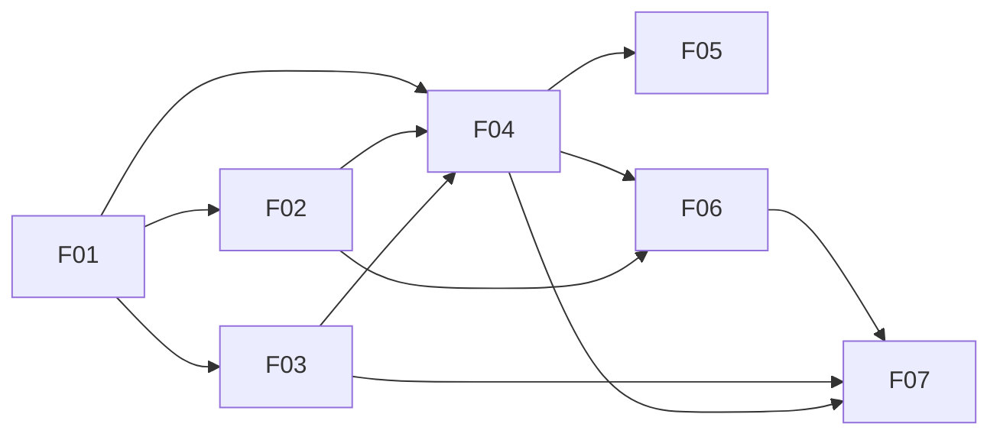

# FinAI — Escopo inicial do MVP

## Situação e objetivo

Catálogo aprovado pelo responsável nesta conversa em 13/11/2026, após esclarecimento expresso de que F01 abrange a adequação visual completa e a correção do layout divergente. Os sete requisitos foram aprovados individualmente e publicados no Redmine como #1016270, #1016271, #1016273, #1016274, #1016275, #1016276 e #1016277, com leitura final, referências e relações conferidas. Nenhum slicing ou implementação realizado neste fluxo.

Permitir controle financeiro pessoal por interface e por um assistente de IA: registrar, editar, excluir e consultar receitas e despesas, visualizar a situação financeira e conversar sobre dados reais. O projeto também serve ao estudo de engenharia de IA, sem transformar escolhas técnicas em requisitos de produto.

## Fontes e evidências

- Escopo fornecido pelo usuário nesta conversa em 13/11/2026, preservado em [sources/escopo-inicial.md](sources/escopo-inicial.md).
- Design fornecido para o FinAI, preservado nas [fontes compartilhadas](sources/FinAI-Controle-Financeiro.zip).
- Arquivos inspecionados no ZIP: `index.html`, `DESIGN-HANDOFF.md` e `DESIGN-MANIFEST.json`. O arquivo também contém `image.png`, `image-1.png` e `image-2.png`; imagens ainda não inspecionadas visualmente.
- O manifesto registra um único HTML. O HTML contém três superfícies navegáveis: Visão geral, Transações e Assistente; inclui formulário de criação/edição, detalhes, confirmação de exclusão e proposta de registro pelo chat.
- O protótipo usa dados locais no navegador e assistente por regras. O escopo do usuário exige persistência no sistema e inteligência artificial. A aparência é referência; esses mecanismos e textos do protótipo não substituem o escopo.
- Projeto inspecionado: `routes/{web,auth,customer,admin,support}.php`, `resources/views/layouts/{app,guest}.blade.php`, `resources/views/dashboard.blade.php`; inventário adicional por `php artisan route:list --except-vendor --no-interaction`. As declarações de rotas Livewire foram lidas diretamente, pois essa listagem não exibiu todas elas.
- Layouts atuais usam tema `remsoft`, fontes Geist/Sora e dashboard de boas-vindas Rem Soft. A referência usa marca FinAI, verde, fundos claros, tipografia de corpo sem serifa e títulos em Georgia. Existe divergência de identidade verificada nos arquivos; não houve comparação de screenshots.
- Não foram encontrados documentos canônicos de domínio nem artefatos anteriores de escopo/requisito na inspeção inicial. As capacidades financeiras não apareceram no inventário de aplicação consultado; isso não comprova ausência de demandas no Redmine.

## Vocabulário de trabalho

- **Transação**: registro financeiro de receita ou despesa. “Movimentação” é usado no escopo como sinônimo.
- **Categoria**: classificação de uma transação, inicialmente predefinida.
- **Proposta de transação**: dados apresentados pelo assistente para revisão; só se torna transação persistida após confirmação.
- **Saldo geral**: todas as receitas menos todas as despesas do histórico do titular, sem saldo inicial separado. **Totais do mês**: somas por tipo no mês/ano selecionado, conforme F05 e Q7 aprovadas.

## Catálogo aprovado

Todos os itens são Features com destino de item próprio, conforme catálogo aprovado. Os códigos são identidades locais; não são IDs do Redmine.

| ID  | Capacidade e objetivo                                                                                      | Limites e aceite resumido                                                                                                                                                                                                                                                                                                                                                                                                                                                     | Fontes                                                                      | Dependências                                              |
| --- | ---------------------------------------------------------------------------------------------------------- | ----------------------------------------------------------------------------------------------------------------------------------------------------------------------------------------------------------------------------------------------------------------------------------------------------------------------------------------------------------------------------------------------------------------------------------------------------------------------------- | --------------------------------------------------------------------------- | --------------------------------------------------------- |
| F01 | Fundação visual FinAI: oferecer identidade e navegação consistentes                                        | Marca, cores, tipografia, estrutura das páginas, navegação adaptável e estados compartilhados conforme referência. Abrange telas existentes, inclusive acesso, recuperação, perfil, gestão e suporte, preservando comportamento/permissões. Não entrega lógica financeira nem páginas futuras vazias. Aceite: cobertura inventariada coerente com o design em desktop, tablet e celular, com controles acessíveis.                                                            | Design; inspeção dos layouts e rotas                                        | Nenhuma                                                   |
| F02 | Acesso autenticado e espaço financeiro pessoal: permitir o uso por qualquer usuário com finanças separadas | Decisão Q1: o MVP terá autenticação e cada usuário terá suas próprias finanças, inclusive nas consultas e registros por IA. Reaproveitar o acesso existente onde atender ao comportamento. Aceite: o usuário acessa seu espaço autenticado e não consulta nem altera registros financeiros de outra pessoa. Detalhes de cadastro e entrada serão definidos na entrevista. Não pressupõe refazer a autenticação nem alterar os papéis administrativos existentes.              | Decisão Q1 do responsável em 13/11/2026; acesso existente                   | F01 para apresentação                                     |
| F03 | Categorias predefinidas: oferecer classificação consistente                                                | Quatro categorias de receita e oito de despesa aprovadas em Q4, comuns a todos, reutilizadas no formulário, histórico e assistente. Sem criação/edição pelo usuário. Aceite: categorias disponíveis e classificação válida nos consumidores, conforme requisito aprovado.                                                                                                                                                                                                     | Seção 3.3; design fornecido; Q4                                             | F01 para apresentação; sem personalização por pessoa      |
| F04 | Gestão de transações: registrar e manter o histórico manualmente                                           | Criar receitas/despesas, editar, excluir, classificar e consultar registros persistidos. Campos visíveis no protótipo: tipo, valor, descrição, categoria e data. Inclui busca por descrição, filtros por tipo/categoria/período, limpeza de filtros, paginação, detalhes e confirmação de exclusão, conforme Q2. Aceite: operações funcionam com dados válidos, falhas são comunicadas e consultas refletem alterações, sempre restritas ao usuário autenticado.              | Seções 3.2 e 4; superfície Transações e diálogos do design; Q1 e Q2         | F01, F02, F03                                             |
| F05 | Dashboard financeiro: mostrar a situação a partir dos registros                                            | Saldo geral, receitas/despesas do mês e movimentações recentes; atualizar após alterações manuais ou pela IA. Inclui balanço visual simples e seletor de mês do protótipo, conforme Q2. Não inclui relatórios avançados. Aceite: indicadores e lista correspondem aos registros do usuário e ao período definido, inclusive sem dados.                                                                                                                                        | Seção 3.1; critérios de sucesso 1 e 2; Visão geral do design; Q1 e Q2       | F01, F04                                                  |
| F06 | Assistente de consulta financeira: conversar e obter respostas sobre dados reais                           | Dona da experiência compartilhada do chat e das consultas financeiras. Consultar dados autorizados, pedir esclarecimentos e comunicar ausência de dados ou indisponibilidade sem inventar valores. Tipos de consulta, continuidade e retenção da conversa serão definidos na entrevista. Não cria transações nesta Feature. Aceite: respostas correspondem aos registros e limites de acesso; erros não se apresentam como resultados financeiros.                            | Seções 3.4 e 4; critério de sucesso 4; Assistente do design                 | F01, F02, F04                                             |
| F07 | Registro de transações por IA com confirmação: transformar mensagens em registros revisados                | Identificar valor, descrição, categoria e demais dados necessários; solicitar informações faltantes; apresentar proposta e exigir confirmação antes de persistir. Inclui revisão, correção e cancelamento da proposta, conforme Q2; tratamento de confirmações repetidas será detalhado. Reutiliza chat de F06 e regras de transação de F04. Aceite: nenhuma gravação antes da confirmação; registro confirmado pertence ao usuário e aparece no histórico e nos indicadores. | Seções 3.4 e 4; critério de sucesso 3; propostas no chat do design; Q1 e Q2 | F03, F04, F06; conferência dos indicadores também usa F05 |

F02 é Feature própria para concentrar a entrada autenticada e a fronteira do espaço financeiro pessoal. A regra de isolamento também integra os critérios de F04/F05/F06/F07. Isso não exige refazer o acesso existente.

F03 delimita o catálogo predefinido solicitado. Qualquer personalização ou manutenção de categorias depende de decisão explícita, sem herdar controles inexistentes ou criar expansão silenciosa.

## Cobertura visual existente a cargo de F01

Inventário das declarações de rotas e views consultadas:

- Login de cliente, administração e suporte.
- Cadastro, recuperação/redefinição de senha, verificação de e-mail e confirmação de senha.
- Dashboard atual e perfil nas áreas de cliente, administração e suporte; formulários de dados pessoais, senha e exclusão de conta presentes no projeto.
- Histórico de notificações nas três áreas e componentes compartilhados de notificações.
- Gestão administrativa de usuários e perfis de acesso, incluindo formulários e ações existentes.
- Suporte: listagem/detalhe de alertas de erros e executor/histórico de comandos Artisan.
- Estrutura compartilhada de cabeçalho, barra lateral, marca, formulários, tabelas, diálogos e feedbacks.

Não há mockups individuais de todas essas telas. A proposta é aplicar a linguagem visual da referência preservando suas funções. Reduzir essa cobertura exige escolha explícita do responsável. As futuras telas financeiras pertencem às Features consumidoras; F01 entrega a base compartilhada.

O manifesto fornece nove dimensões para futura validação visual: 360×800, 390×844, 430×932, 600×960, 820×1180, 1024×768, 1366×768, 1440×900 e 1920×1080. Ainda não houve execução ou aprovação dessa validação.

## Dependências e ordem sugerida

As setas representam dependência de entrega da capacidade, incluindo apresentação, não tarefas técnicas. As relações remotas efetivamente publicadas e conferidas constam abaixo. O uso de F01 em F02 limita-se à apresentação do acesso; F03 é catálogo comum sem personalização por pessoa.

Ordem topológica sugerida: F01; F02 e F03, independentes entre si; F04; F05 e F06, independentes entre si; F07. F07 precisa de F05 disponível para verificar o critério integrado dos indicadores, sem depender dos cálculos de dashboard para registrar.

## Limites fornecidos pelo responsável

Fora do MVP: integração bancária, importação de extratos, cartões de crédito, metas financeiras, relatórios avançados, gestão empresarial e múltiplos agentes de IA.

Evoluções futuras, sem publicação proposta neste catálogo: análises inteligentes, automações, importação de documentos, recomendações personalizadas e funcionalidades para autônomos/pequenos negócios.

## Decisões do responsável e pendências

Decisões confirmadas nesta conversa em 13/11/2026:

1. **Q1 resolvida:** “qualquer usuário [...] vamos ter [autenticação], ou seja cada usuário tem suas finanças separadas”. O produto atende várias pessoas, com entrada autenticada e isolamento dos dados financeiros em todos os canais. Os detalhes de cadastro e entrada pertencem à entrevista de F02.
2. **Q2 resolvida:** “sim, tudo entra”, em resposta à inclusão de busca/filtros/paginação/detalhes, seleção de mês, balanço simples e correção/cancelamento da proposta da IA. As capacidades foram incorporadas a F04/F05/F07; seus detalhes serão definidos nos respectivos requisitos.

3. **Catálogo aprovado:** após confirmar que F01 inclui a adequação visual inteira e o ajuste do layout divergente, inclusive telas existentes sem mockup próprio, o responsável respondeu “Então eu aprovo”. A aprovação abrange os sete itens, seus limites e dependências; não representa aprovação de requisitos individuais ou publicação.
4. **Destino escolhido:** projeto FinAi (65224, identificador `finai`), versão aberta Livewire (20359), selecionada explicitamente pelo responsável. A outra versão aberta, Sprint 1 (20355), não é o destino deste catálogo.
5. **Q3 resolvida:** o responsável confirmou “Sim, exigir” à confirmação de e-mail antes de usar as finanças. F02 inclui autenticação e confirmação do e-mail atual como condições para acesso financeiro; reenvio e saída permanecem disponíveis na espera.
6. **Q4 resolvida:** o responsável confirmou a lista de categorias do design fornecido: receitas — Salário, Freelance, Rendimentos, Outras receitas; despesas — Alimentação, Moradia, Transporte, Saúde, Educação, Lazer, Compras, Outras despesas. Catálogo comum, vinculado ao tipo da transação e sem manutenção pelo usuário no MVP.
7. **Q5/Q6 resolvidas:** o responsável concordou com transações realizadas com data até hoje, sem lançamentos futuros, e com exclusão após confirmação, sem desfazer, retirando o registro do histórico e dos totais.
8. **Q7 resolvida:** o responsável confirmou saldo geral de todo o histórico, sem saldo inicial separado; receitas, despesas e balanço do mês selecionado, inicialmente o corrente; cinco recentes de todo o histórico; Ver todas abrindo o histórico completo. Trocar o mês não altera saldo geral ou recorte dos recentes.
9. **Q8/Q9 resolvidas:** o responsável confirmou uma conversa contínua salva por usuário e retomada em outro navegador, sem gestão de várias conversas; saldo geral, somas/contagens por mês/dia/intervalo com categoria, cinco recentes e continuidade contextual. Sem período ou contexto claro, totais usam mês corrente; saldo/recentes usam todo o histórico; ambiguidade exige esclarecimento.
10. **Q10/Q11 resolvidas:** várias movimentações por mensagem, com propostas e ações individuais. O responsável determinou que campos nunca sejam completados silenciosamente; a IA apresenta sugestões e pergunta se podem ser adotadas. Data/categoria omitidas não são assumidas automaticamente. Aceitação de campos precede revisão e confirmação final da transação.

Na entrevista de cada item, após catálogo aprovado: categorias exatas; dados obrigatórios e regras de datas/valores; moeda e período; cálculo do saldo; efeitos de edição/exclusão; consultas suportadas; retenção e continuidade do chat; confirmação/correção/cancelamento e falhas da IA. Questões técnicas de provedor ou implementação não são decisões funcionais deste documento.

Adaptações propostas: substituir os textos de armazenamento local e assistente simulado por mensagens coerentes com persistência real e IA real; preservar hierarquia e linguagem visual. Decisão de negócio prevalece sobre regras demonstrativas do protótipo, mediante revisão.

## Revisão, publicação e passagem

- Revisão do catálogo: aprovada nesta conversa em 13/11/2026, após esclarecimento da cobertura integral de F01.
- Destino Redmine: projeto FinAi (65224), versão Livewire (20359), aberta, sem data de entrega. A versão estava sem issues antes da criação autorizada de #1016270.
- Similaridade: a Sprint 1 contém cinco Features e suas filhas, incluindo #1016101 — Adequação visual do FinAI, com outro inventário e filhas encerradas. A criação própria da F01 na versão Livewire foi aprovada; os registros anteriores foram preservados.
- F01: [requisito aprovado](../../features/1016270-adequacao-visual-completa-do-finai/feature.md), [Feature #1016270](https://redmine.remsoft.com.br/issues/1016270), publicada na versão Livewire com status New; descrição, campos e referência definitiva relidos e conferidos. Pronta para passagem a project-slices, sem tarefas ou implementação.
- F02: [requisito aprovado](../../features/1016271-acesso-autenticado-e-espaco-financeiro-pessoal/feature.md), [Feature #1016271](https://redmine.remsoft.com.br/issues/1016271), publicada e relida na versão Livewire com status New. Referência definitiva conferida; relação #877 confirmada nos dois endpoints: F01 #1016270 bloqueia F02 #1016271. Pronta para project-slices, sem slicing ou implementação.
- F03: [requisito aprovado](../../features/1016273-categorias-predefinidas/feature.md), [Feature #1016273](https://redmine.remsoft.com.br/issues/1016273), publicada e relida na versão Livewire com status New. Referência definitiva conferida; relação #878 confirmada nos dois endpoints: F01 #1016270 bloqueia F03 #1016273. Pronta para project-slices, sem slicing ou implementação.
- F04: [requisito aprovado](../../features/1016274-gestao-de-transacoes/feature.md), [Feature #1016274](https://redmine.remsoft.com.br/issues/1016274), publicada e relida na versão Livewire com status New. Limites de campos, referência de hoje, recorte inicial e paginação aprovados na revisão completa. Referência definitiva e relações #879/#880/#881 conferidas: F01/F02/F03 bloqueiam F04. Pronta para project-slices, sem slicing ou implementação.
- F05: [requisito aprovado](../../features/1016275-dashboard-financeiro/feature.md), [Feature #1016275](https://redmine.remsoft.com.br/issues/1016275), publicada e relida na versão Livewire com status New. Referência definitiva e relações #882/#883 conferidas: F01/F04 bloqueiam F05. Pronta para project-slices, sem slicing ou implementação.
- F06: [requisito aprovado](../../features/1016276-assistente-de-consulta-financeira/feature.md), [Feature #1016276](https://redmine.remsoft.com.br/issues/1016276), publicada e relida na versão Livewire com status New. Limite de 500 caracteres e estados aprovados na revisão completa. Referência definitiva e relações #884/#885/#886 conferidas: F01/F02/F04 bloqueiam F06. Pronta para project-slices, sem slicing ou implementação.
- F07: [requisito aprovado](../../features/1016277-registro-de-transacoes-por-ia-com-confirmacao/feature.md), [Feature #1016277](https://redmine.remsoft.com.br/issues/1016277), publicada e relida na versão Livewire com status New. Referência definitiva e relações #887/#888/#889 conferidas: F03/F04/F06 bloqueiam F07. Pronta para project-slices, sem slicing ou implementação.
- Publicação: cada requisito completo e operações exatas serão apresentados para revisão antes da escrita, conforme o fluxo invocado.
- Slicing e implementação: não realizados e fora desta etapa. Os sete requisitos aprovados e respectivos pais remotos confirmados estão prontos para `project-slices`.

## Passagem consolidada para project-slices

| Item                            | Requisito definitivo                                                                           | Pai remoto                                                | Dependências publicadas              |
| ------------------------------- | ---------------------------------------------------------------------------------------------- | --------------------------------------------------------- | ------------------------------------ |
| F01 — Adequação visual completa | [feature.md](../../features/1016270-adequacao-visual-completa-do-finai/feature.md)             | [#1016270](https://redmine.remsoft.com.br/issues/1016270) | Nenhuma                              |
| F02 — Acesso e espaço pessoal   | [feature.md](../../features/1016271-acesso-autenticado-e-espaco-financeiro-pessoal/feature.md) | [#1016271](https://redmine.remsoft.com.br/issues/1016271) | F01, relação #877                    |
| F03 — Categorias                | [feature.md](../../features/1016273-categorias-predefinidas/feature.md)                        | [#1016273](https://redmine.remsoft.com.br/issues/1016273) | F01, relação #878                    |
| F04 — Transações                | [feature.md](../../features/1016274-gestao-de-transacoes/feature.md)                           | [#1016274](https://redmine.remsoft.com.br/issues/1016274) | F01/F02/F03, relações #879/#880/#881 |
| F05 — Dashboard                 | [feature.md](../../features/1016275-dashboard-financeiro/feature.md)                           | [#1016275](https://redmine.remsoft.com.br/issues/1016275) | F01/F04, relações #882/#883          |
| F06 — Consultas por IA          | [feature.md](../../features/1016276-assistente-de-consulta-financeira/feature.md)              | [#1016276](https://redmine.remsoft.com.br/issues/1016276) | F01/F02/F04, relações #884/#885/#886 |
| F07 — Registro por IA           | [feature.md](../../features/1016277-registro-de-transacoes-por-ia-com-confirmacao/feature.md)  | [#1016277](https://redmine.remsoft.com.br/issues/1016277) | F03/F04/F06, relações #887/#888/#889 |

Todos os pais pertencem ao projeto FinAi (65224), versão Livewire (20359), tracker Feature, status New, sem Sequencing reservado. Relações são direcionadas do bloqueador ao dependente. A reserva de sequência e a decomposição DEV/QA pertencem a project-slices; nenhuma tarefa foi criada por este fluxo.

Fontes compartilhadas preservadas em `sources/`: escopo inicial e design fornecido. O ZIP está disponível localmente; não foi anexado às issues do Redmine. Essa condição foi informada ao responsável durante a F01, que escolheu seguir ao próximo requisito. O próximo papel dispõe da fonte neste repositório; não presumir anexo remoto.

Ordem sugerida para a próxima etapa: F01; F02 e F03; F04; F05 e F06; F07. Começar pela F01 #1016270. Não há publicação incerta nem decisão funcional material pendente nos sete requisitos aprovados. Publicação concluída não comprova implementação, validação visual ou conclusão do MVP.
